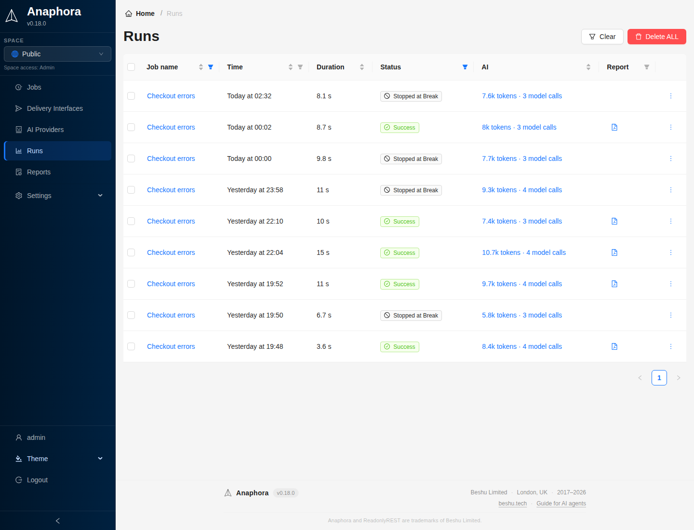

# Runs

The Runs section shows the execution history of your jobs, including successful captures, failures, and delivery status.

## Overview

Each time a job runs, Anaphora makes a run record. Use it to:

- Track job execution history
- Identify and debug failures
- Review captured content
- Verify delivery success

## Run statuses

| Status               | Description                                                                                      |
|----------------------|--------------------------------------------------------------------------------------------------|
| **Success**          | The job completed and the report was delivered                                                   |
| **Delivery issue**   | The report was created, but it could not be delivered to all destinations                        |
| **Error**            | The job execution failed                                                                         |
| **Stopped at Break** | The run stopped as planned: a **Break**, or a hits condition that was not met. It made no report |

Click an **Error** or **Delivery issue** tag to see the details.

When a filter or a sort is on, **Clear**, at the top of the page next to **Delete ALL**, removes them.

The **AI** column says what the AI steps of each run cost: see [Runs](../jobs/ai-step.md#runs).

In a window from 1,024 px wide, a job name of two words, such as "Checkout errors", stays on one line while the
**Attempts** column does not show.

## Retries and attempts

A retry is not a separate run. Anaphora lists the retries under the run that failed first, and the **Attempts** column
counts them. The column shows only when a run in the list, on any page, was retried, or when its filter is on. When you
delete a run, its retries and their files go with it.

The **Status** and **Report** filters read the latest attempt of a run. So a run whose retry succeeded is listed as a
success.

## Status on the Jobs list

The Jobs list shows the result of the last run of each job:

| Status             | Description                                                                 |
|--------------------|-----------------------------------------------------------------------------|
| **Success**        | The report was delivered                                                    |
| **Error**          | The run failed                                                              |
| **Delivery issue** | A destination refused the report                                            |
| **Not delivered**  | Anaphora withheld the report because a text block of the template failed   |
| **No runs**        | The job did not run yet                                                     |
