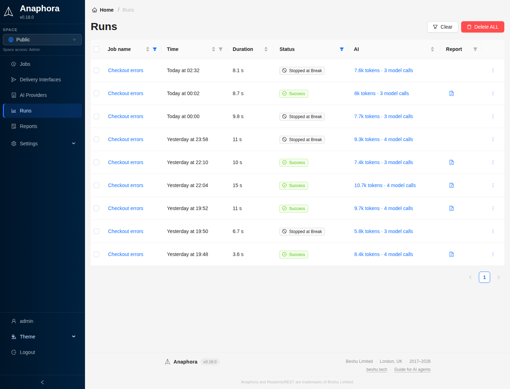

# Runs

The Runs section shows the execution history of your jobs, including successful captures, failures, and delivery status.

## Overview

Each time a job runs, Anaphora makes a run record. Use it to:

- Track job execution history
- Identify and debug failures
- Review captured content
- Verify delivery success

## Run statuses

| Status               | Description                                                                                      |
|----------------------|--------------------------------------------------------------------------------------------------|
| **Success**          | The job completed and the report was delivered                                                   |
| **Delivery issue**   | The report was created, but it could not be delivered to all destinations                        |
| **Error**            | The job execution failed                                                                         |
| **Stopped at Break** | The run stopped as planned: a **Break**, or a hits condition that was not met. It made no report |
| **Skipped**          | The run made the report, and the [condition](../jobs/delivery.md#send-through-a-delivery-only-if) of every delivery failed. Nobody got it, as planned. A run whose recipients all snoozed the job is also **Skipped** |
| **Throttled**        | The run came inside the [throttle](../jobs/general.md#notification-throttling) time of its job. It ran its capture, sent nothing and made no report |

The **Status** filter has an option for each of these states. **Success** does not list throttled or skipped runs.
The Reports page and the Overview count a throttled run as no report, because it made none. So after an upgrade from
0.18.0 these counts can fall. Your reports are the same. A run of May 2025 or later that an older version stored as
**Success** reads as **Throttled** now. Older runs keep their state.

Click an **Error** or **Delivery issue** tag to see the details. There, a delivery that its condition skipped shows
"Skipped: its condition did not hold, so nothing was sent."

When a filter or a sort is on, **Clear**, at the top of the page next to **Delete ALL**, removes them.

The **AI** column says what the AI steps of each run cost: see [Runs](../jobs/ai-step.md#runs).

In a window from 1,024 px wide, a job name of two words, such as "Checkout errors", stays on one line while the
**Attempts** column does not show.

## Run warnings

A run can finish and still have something to tell you. Anaphora stores such a note as a warning on the run. A warning
never changes the state of the run: the report is still sent.

- The **Runs** page has a narrow column with an icon and the number of warnings. Its tooltip and a window show the
  sentences. The filter **With warnings** lists the runs that have one.
- The **Jobs** list marks a job whose last run has warnings. The mark links to the Runs page of that job, filtered.
- The JSON API run object has `warnings` and `warningMessages`.
- A run stores at most 50 warnings. The last one says how many were left out. A warning holds no address, pattern,
  template, header, password or captured text.

| When the run notes it                                                                                                  | What to do                                                                                               |
|------------------------------------------------------------------------------------------------------------------------|----------------------------------------------------------------------------------------------------------|
| A wait or a delivery succeeded, but took more than 80% of its [time limit](../getting-started/installation.md#time-limits). The run stores the longest one for each limit | Raise the variable that the sentence names, before a slow day makes the run fail                         |
| A page did not finish loading within the navigation limit. The capture went on with the page it has                    | Open the report. If the page is slow every day, raise `NAVIGATION_TIMEOUT_SECONDS`                       |
| Kibana did not finish loading within its wait                                                                           | Open the report. To raise the wait, set `CAPTURE_STEP_TIMEOUT_SECONDS` above 300                         |
| Some Grafana panels had not finished drawing when the capture stopped waiting                                           | Look at the report. Raise `CAPTURE_STEP_TIMEOUT_SECONDS`, or lighten the dashboard                       |
| The capture could not tell which Grafana panels had drawn (Grafana 12.2 unloads panels that are out of view)            | Upgrade Grafana to 12.3 or later                                                                         |
| The auto refresh of a Grafana dashboard could not be turned off for the capture                                         | Turn off the auto refresh in Grafana, then look at the report                                            |
| Metabase card queries were still running when the capture read the page                                                 | See [Metabase dashboards](../jobs/capture.md#metabase-dashboards)                                        |
| A "Process text" replacement uses a regular expression that Anaphora does not support, so it was skipped               | Rewrite the pattern in RE2 syntax, or turn off the regex button of the replacement                       |
| A webhook interface sets a forwarding header. Anaphora does not send it                                                | Remove the header from the delivery interface                                                            |
| The [outbound policy](../getting-started/installation.md#what-a-capture-and-a-delivery-may-reach) refused a request of the captured page | If the host is yours, list it in `OUTBOUND_ALLOWED_HOSTS`                                                |

The [health monitoring](../administration/self-monitoring.md#run-warning-mail) can mail you when the last run of a job
gets a warning that it did not have before.

## Retries and attempts

A retry is not a separate run. Anaphora lists the retries under the run that failed first, and the **Attempts** column
counts them. The column shows only when a run in the list, on any page, was retried, or when its filter is on. When you
delete a run, its retries and their files go with it.

The **Status** and **Report** filters read the latest attempt of a run. So a run whose retry succeeded is listed as a
success.

## Status on the Jobs list

The Jobs list shows the result of the last run of each job:

| Status             | Description                                                                 |
|--------------------|-----------------------------------------------------------------------------|
| **Success**        | The report was delivered                                                    |
| **Error**          | The run failed                                                              |
| **Delivery issue** | A destination refused the report                                            |
| **Skipped**        | The condition of every delivery failed, so the report went to nobody        |
| **Not delivered**  | Anaphora withheld the report because a text block of the template failed   |
| **No runs**        | The job did not run yet                                                     |
