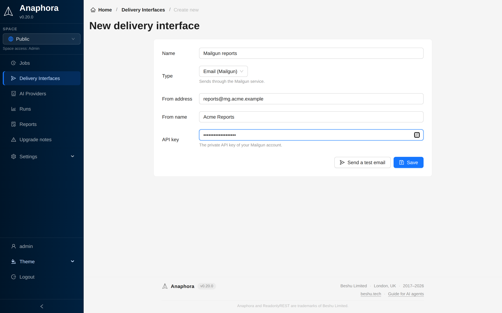

# Mailgun

Send reports via the Mailgun email API.

## Why Mailgun?

- No SMTP server to manage
- Better deliverability tracking
- Easy setup
- Higher sending limits

## Configuration

Choose **Email (Mailgun)** as the **Type**.

| Field        | Description                                                                     | Required |
|--------------|---------------------------------------------------------------------------------|----------|
| Name         | Interface identifier                                                            | Yes      |
| From address | Your Mailgun domain with any name, for example myname@my-mailgun-domain.com     | Yes      |
| From name    | The name to show as the sender                                                  | Yes      |
| API key      | The private API key of your Mailgun account (at least 10 characters). It shows as dots | Yes      |

## Setup steps

### 1. Get API credentials

1. Log in to Mailgun
2. Navigate to **Settings** > **API Keys**
3. Copy your Private API Key
4. Note your Mailgun sender domain (to use in **From address**)

## Domain verification

Make sure your Mailgun domain is verified for best deliverability:

- Add DNS records as instructed by Mailgun
- Verify SPF and DKIM are configured

## Sending behavior

Anaphora sends up to 3 messages at the same time, in the order of the recipients. One message may take at most 5 minutes.
This limit is fixed. When one message ends at that limit before any message of the delivery went through, Anaphora does
not start the others. Mailgun is not answering, and the run is retried. Once one message went through, the others still
go out.

A Mailgun request that Anaphora gave up on can still run for up to 5 minutes. If Mailgun accepts it late, the retry of
the run can send the same message twice.

## Testing

Click **Send a test email**, enter a **Send to** address (and optionally a **Subject** and a **Message**), then click
**Send**. Do this before you use the interface in jobs.
