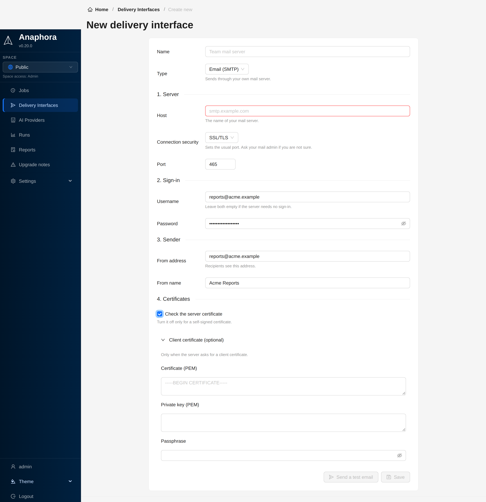

# SMTP

Send reports through your own SMTP server, with unencrypted, STARTTLS or SSL/TLS connections.



## Configuration

Choose **Email (SMTP)** as the **Type**. After **Name** and **Type**, the form has four sections, in the order of the
work: the server, the sign-in, the sender and the certificates.

| Section      | Field                          | Description                                                                            | Required |
|--------------|--------------------------------|----------------------------------------------------------------------------------------|----------|
|              | Name                           | The name of the interface in Anaphora                                                  | Yes      |
| Server       | Host                           | The name of your SMTP server                                                           | Yes      |
| Server       | Connection security            | **None**, **STARTTLS** or **SSL/TLS**. Choosing one also sets the usual port.           | Yes      |
| Server       | Port                           | SMTP port (25, 587, 465)                                                               | Yes      |
| Sign-in      | Username                       | SMTP login. Leave **Username** and **Password** empty if the server needs no sign-in.  | No       |
| Sign-in      | Password                       | SMTP password                                                                          | No       |
| Sender       | From address                   | The address that recipients see                                                        | Yes      |
| Sender       | From name                      | The name that recipients see                                                           | Yes      |
| Certificates | Check the server certificate   | Refuse a server certificate that does not verify. On by default. Turn it off only for a self-signed certificate. | No       |
| Certificates | Certificate (PEM), Private key (PEM), Passphrase | A client certificate, for servers that ask for one (**SSL/TLS** only). Open **Client certificate (optional)** to show them. | No       |

The **Certificates** section shows when **Connection security** is **STARTTLS** or **SSL/TLS**.

## Common configurations

### Gmail

```
Host: smtp.gmail.com
Port: 587
Connection security: STARTTLS
```

:::note
Gmail requires an App Password if 2FA is enabled.
:::

### Office 365

```
Host: smtp.office365.com
Port: 587
Connection security: STARTTLS
```

### Amazon SES

```
Host: email-smtp.us-east-1.amazonaws.com
Port: 587
Connection security: STARTTLS
```

## Testing

1. Fill in the interface. The test button is off until the marked fields are filled in.
2. Click **Send a test email**.
3. In the **Send to** field, enter the address that gets the test email. **Subject** and **Message** are optional.
4. Click **Send**, and make sure that the email arrives. Anaphora says "Test email sent. Check the inbox.".

## Sending behavior

Anaphora sends the emails of a run one at a time, over one connection. So a server that allows few connections accepts
every recipient. After a server failure, Anaphora marks the other recipients as failed at once.

One mail may take at most 5 minutes. `SMTP_DELIVERY_TIMEOUT_SECONDS` changes this limit (60 to 600 seconds): see
[Time limits](../getting-started/installation.md#time-limits). A mail that does not finish in time fails with "The
delivery did not finish within … and was stopped." A relay that stays silent for a fifth of the limit (at least
60 seconds) ends the connection. The [outbound policy](../getting-started/installation.md#what-a-capture-and-a-delivery-may-reach)
refuses an SMTP host on a cloud metadata or link-local address, and on a port of Anaphora itself.

## Troubleshooting

| Issue                 | Solution                                |
|-----------------------|-----------------------------------------|
| Connection refused    | Check firewall, verify port             |
| Authentication failed | Verify credentials, check app passwords |
| TLS error             | Try another connection security mode    |
