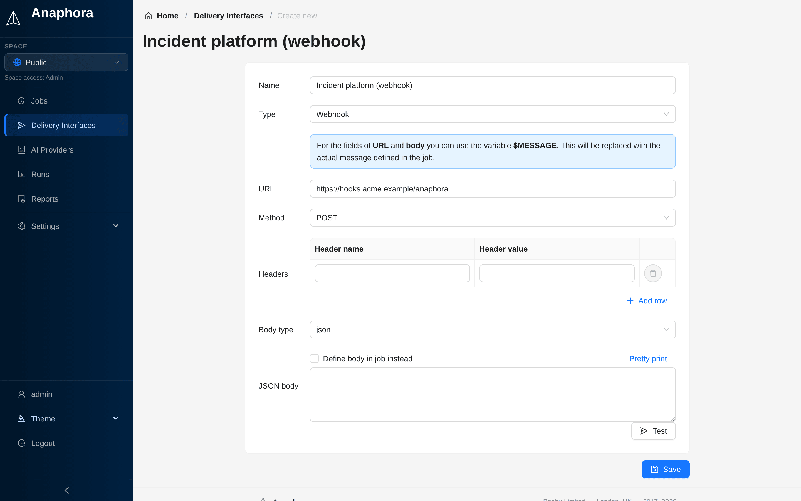

# Webhook

Send reports to custom HTTP endpoints for integration with any system.



## Use cases

- Custom notification systems
- Integration with ticketing tools
- Triggering automation workflows
- Sending to unsupported platforms

## Configuration

| Field     | Description                                         | Required |
|-----------|-----------------------------------------------------|----------|
| Name      | Interface identifier                                | Yes      |
| URL       | Endpoint URL. Can contain `$MESSAGE`                | Yes      |
| Method    | HTTP method (`GET` or `POST`, default `POST`)       | Yes      |
| Headers   | Custom headers (**Header name**, **Header value**)  | No       |
| Body type | `json` or `form`. Shown only for `POST`             | Yes      |
| JSON body | Custom payload template (body type `json`)          | No       |
| Form body | Key-value pairs (body type `form`)                  | No       |

## Payload format

### JSON template

Define a JSON structure that works with your endpoint in **JSON body**. Use the ```$MESSAGE``` variable as a placeholder
for the report content. Anaphora replaces this variable with the text that you define in the job's delivery settings.
Click **Pretty print** to format the JSON.

Example:

```json
{
  "title": "Anaphora Report",
  "content": "$MESSAGE"
}
```

### Form body

Send key-value pairs (**Form name**, **Form value**) as form data. Use the ```$MESSAGE``` variable for the report content.

Example:

```
report_title=Anaphora Report
report_content=$MESSAGE
```

### JSON in job delivery

Select **Define body in job instead**. Each job then defines the entire JSON body in its delivery settings.

## Custom headers

Add headers for authentication or routing:

```
Authorization: Bearer your-token
X-Custom-Header: value
```

Anaphora sets `Content-Type` from the body type.

Anaphora never sends a forwarding header: `X-Forwarded-For`, `X-Forwarded-Host`, `X-Forwarded-Proto`, `X-Forwarded-Port`,
`Forwarded`, `X-Real-IP`, `X-Client-IP`, `True-Client-IP` or `CF-Connecting-IP`. It drops the header and the delivery
goes on without it. The run stores a [warning](../data-retention/runs.md#run-warnings), and the next save of the
interface is refused until you remove the header. A receiver that needs the address of the sender reads it from the
connection.

## Testing

Click **Test**, enter an optional **Test message**, then click **Send to webhook**.

## Response handling

A delivery succeeds only when the webhook answers with a 2xx status. Any other answer fails the delivery, and the run
shows the status and the answer of the webhook. The **Test** button, the health monitor, the license alert and the AI
budget alert use the same check.

A webhook call stops after 60 seconds. This limit is fixed.

Anaphora does not follow a redirect. An answer with a 3xx status and a `Location` header fails the delivery. The status
of the run and the **Test** button say, for example, "Webhook answered 301, a redirect to hooks.example. Anaphora does
not follow redirects: enter the final URL in the webhook interface." The text names the host only, never the path. Enter
the final URL in the interface. A run is not retried when every failed delivery got a redirect, because a retry fails in
the same way. A 3xx answer with no `Location` header (a 304, for example) is not a redirect and keeps its plain text.

A webhook cannot point at a port of Anaphora itself, and the [outbound
policy](../getting-started/installation.md#what-a-capture-and-a-delivery-may-reach) refuses a cloud metadata or
link-local address.

:::warning Test route removed
The route `/guest/api/test/webhook` no longer exists. If a webhook interface points at it, point it at a real receiver.
A webhook that answers "not found" fails the delivery.
:::
