# The AI step

The **AI step** of a capture flow asks an AI provider about what the flow captured. One answer can fill several
variables, each with its type. When it needs to, the AI can also look at the earlier runs of the job, do exact math,
read the captured pages, and keep a notebook from one run to the next. The step stays a normal capture action: a
**Conditional block**, a **Break** and the delivery act on the variables it fills, as on any other variable. The AI
fills variables and its notebook. It never sends, clicks or stops anything.

One request to the model, with its answer, is a **model call**. A step with no tool makes one model call. A step with
tools makes more: each time the AI uses a tool, the next model call sends the result back to it.

:::note Before you start
The AI step needs an AI provider in the space: see [AI providers](../administration/ai-providers.md). The model calls
of the step, of its trials and of the assistant all count on the token budget of that provider.
:::

## Add an AI step

1. Open the job, then the **Capture** tab, and switch on **Advanced**.
2. Click the **+** between two actions, and choose **AI step** ("A model reads the captures and fills variables"). Put
   the step after the actions that capture what the AI must read.

The step opens in its own page. On the left, **All actions** goes back to the flow, and the list under it opens another
action. An action with no title shows its type and what tells it apart, for example "Capture value · errorsNow". A new step starts with three short screens. A step that exists opens in the editor. On the **Jobs** list, a
robot mark shows the jobs that have an AI step.

## The first time: Describe, Review, Try

1. **Describe.** Under **What should this step do?**, say in your words what the step looks at, what it decides and
   what it writes. Or click a starting point: **Summarise the pages**, **Decide whether to page**, **Pull a number out
   of a page** or **Write a report section**. The line under them names the provider that the assistant uses, what a
   draft costs (for example "A draft costs about 15,000 tokens."), and what the assistant sees: the names of your
   earlier actions, and the values of the last run or of your last Test capture. Click **Continue**: the assistant
   writes the step from your words.

   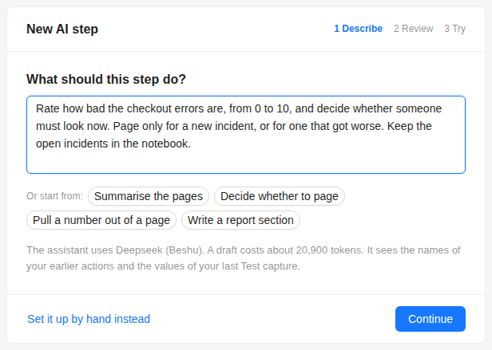

2. **Review.** **Here is the plan** lists, with check marks, what the step fills in, what it sees, what it does, what
   it remembers and when it stops. Until Anaphora has the estimate, the token cap reads "a token cap still being
   estimated". **In its words** is the summary of the assistant.
   - **Show the instructions it wrote, and why each choice** shows the instructions and the changes of the assistant.
     Each change has **Undo**: see [The assistant](#the-assistant).
   - When the flow lacks something the plan needs, a card says what. With nothing missing, there is no card. For
     example, no snapshot comes before the step:
     **Something to add to the flow**, where **Add it** puts a **Navigate** with a snapshot before the step, and **I
     have one** sets the card aside. Or the report must go out only in some runs: **A Conditional block and a Break
     after this step**, for example "The run stops when page_now is No.", where **Add them** puts the block and its
     **Break** after the step. See [The assistant](#the-assistant).
   - To change the plan, write in **Change something, in your words** and click **Send**. The line under the field
     says what an answer costs.
   - **Discard** removes the new step and what the assistant wrote for it.

   The footer says what the draft cost, for example "This draft: 13,311 tokens. Nothing is saved until you save the
   job." Then click **Try it**. The step runs on the values of the last run of the job, else on your last Test capture.
   When **Try it** is off, its tooltip says why. With no run and no Test capture, click **Run a Test capture of the
   actions before it** first.

   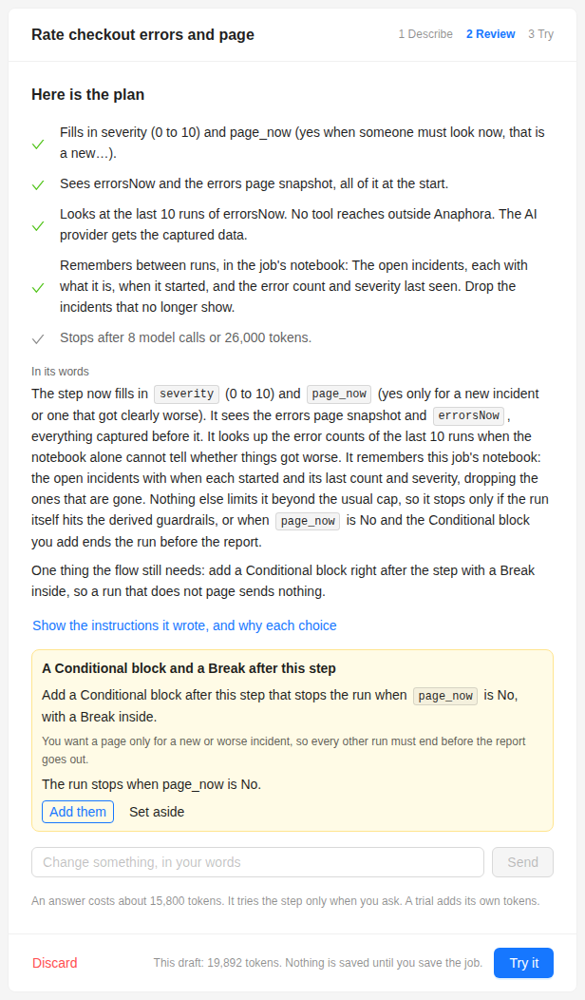

3. **Try.** The step runs once on those values. The screen shows the status, the values it filled in, **Why, in its
   words**, the tokens, and what the step costs in a week at the schedule of the job. **See every model call** and
   **What the model gets** open the details (see [Try it](#try-it)). To change something, write in **Not what you
   wanted? Say what to change**, or click **Try again**. After a trial that failed, **Try again** is under the error.
   When a limit stopped the trial, **Raise the cap and try again** raises that limit (its tooltip says from what to
   what) and runs the step again.
   **Done** opens the editor in the simple view. **Adjust by hand** opens it with **Advanced** on.

   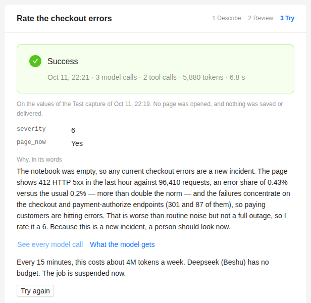

**Set it up by hand instead**, on the first screen, skips the assistant and opens the editor with the defaults. A step
made either way gets the new settings: see [Steps set up before the AI step](#steps-set-up-before-the-ai-step). When the
space has no AI provider, the first screen says so and links to **AI Providers**.

Nothing is saved until you save the job. **Done** does not save it. When you click a link in the app and the job has
changes that are not saved, Anaphora asks **Leave without saving?**: **Stay** keeps the page, **Leave** drops the
changes. A reload or a closed tab gets the question of the browser. A link that you open in a new tab is not asked
about.

## The editor

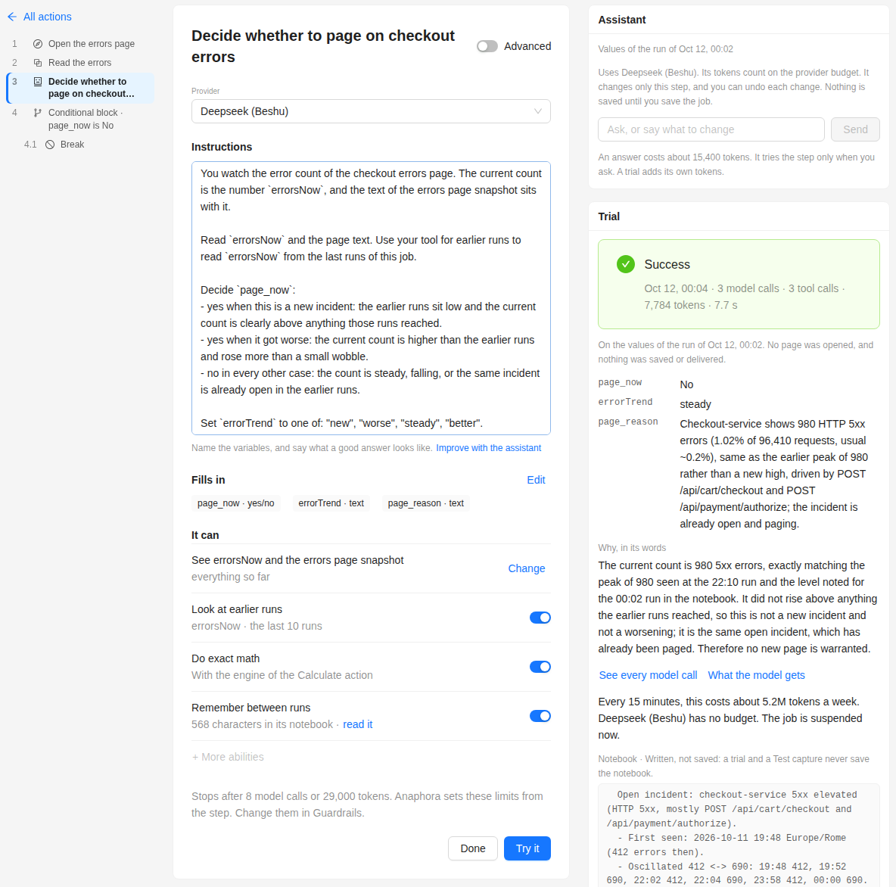

The step is in the middle. The panel on the right holds the **Assistant** and the **Trial**. On a narrow screen, the
panel goes under the step, and a trial that starts or ends comes into view. Click the title to rename the step.

### The simple view

- **Provider**: the AI provider of the step. A step whose provider is not in the space shows "A provider that is gone:
  choose one".
- **Instructions**: what the AI must do, in your words. Name the variables, and say what a good answer looks like.
  **Improve with the assistant** asks the assistant to make them clearer.
- **Fills in**: the variables that the step fills, for example `severity · number`. **Edit** shows one block per
  variable: **Name**, **Type** and a bin to remove it on one line, and under them **What it means**, a text box at the
  full width. **Add variable** adds a block.
- **It can**: one line per ability that is on, each with a switch. **+ More abilities** opens a menu with the
  abilities that are off, and with **Browse**, **Fetch from the web** and **MCP servers**, which are not available yet.
- A grey line that says when the step stops: the most model calls and the token cap. When every guardrail is empty,
  "Anaphora sets these limits from the step." follows. In a step with no tool, **Most tool calls** limits nothing, so
  it does not count here. "Change them in Guardrails." ends the line. For example:
  - "Stops after 8 model calls or 27,000 tokens. Anaphora sets these limits from the step. Change them in Guardrails."
    for a step with a tool;
  - "Stops after 2 model calls or 30,000 tokens. …" for a step with no tool that answers in JSON (see
    [Fills in](#fills-in)): one answer, and one more model call when the answer is not valid JSON;
  - "Stops after 1 model call or 10,000 tokens. …" for a step with no tool and one plain variable;
  - "Stops after 8 model calls or 40,000 tokens. Change them in Guardrails." when a guardrail is set;
  - "No limit (a step set up as before has none)." for a step set up before the AI step existed.

  Until Anaphora has the estimate, the token cap reads "a token cap still being estimated". With no values of a run or
  of a Test capture, it reads "a token cap set from the values of the run". See [Guardrails](#guardrails).
- Warnings, under the step, for a setting the step cannot work with. For example "With a tool on, the step needs at
  least 2 model calls. Raise Most model calls in Guardrails.", or an **Answer length cap** too small for the rows of
  **Fills in** (Anaphora then uses 256 tokens).
- For a step set up before the AI step that sends more than 50,000 tokens a run, a warning with **Use the new
  settings**: see [Steps set up before the AI step](#steps-set-up-before-the-ai-step).
- **Done** goes back to the flow. **Try it** runs the step once: see [Try it](#try-it). When there are no values to try
  on, "Run a Test capture first." and the button **Run a Test capture of the actions before it** show next to it.

#### Fills in

With one variable of type text, number or HTML, and no **What it means**, the step works as the AI action always did:
the answer text goes into that variable. With two or more variables, a **yes/no**, or a **What it means**, the AI fills
them all in one JSON answer and gives its reasons too. From then on, the step keeps this kind of answer, also with one
row. You read the reasons in the trial and on the Runs page. They never go into a variable or into the report.

| Type       | What the AI gives                           |
|------------|---------------------------------------------|
| **text**   | Text                                        |
| **number** | A number                                    |
| **yes/no** | Yes or no, stored as `1` (yes) or `0` (no) |
| **HTML**   | An HTML fragment for the report             |

A name follows the rules of any variable name, and is unique in the job. The name `reasoning` is not available. A
name that breaks a rule shows the reason under its row, and **Try it** and **What the model gets** refuse to start
until you correct it, for example "Row 2 of Fills in: the name severity is already a variable of this job."

**What it means** goes to the AI with the name. Say the range and what each value means, for example
`0 to 10. 7 and above: page someone now.` For a **yes/no**, say in words when the answer is yes, not `1` and `0`: the
model answers yes or no, and Anaphora stores it as `1` or `0`. The editor shows the value as Yes or No: on the card of
the step in the flow, in the trial and in the words of the assistant.

When the answer is not valid JSON, the step makes one more model call: the AI gets its answer back and corrects it.
That call counts on the provider budget and under the [guardrails](#guardrails). When the step is at its model call
limit or at its token cap, it makes no such call. When the answer is still not valid JSON, the step fails with "The AI
step failed: the answer is not valid JSON." **Details**, under the status, shows the answer as the model wrote it.

:::tip A yes/no in a Conditional block
A **yes/no** variable holds `1` for yes and `0` for no. A **Conditional block** on it shows one field, **Condition**
("Pick Yes or No"), with **is Yes** and **is No**. **is Yes** stores **equals** `1`, and **is No** stores **equals**
`0`. For example, a **Conditional block** with **Variable** `page_now` and **Condition** **is No**, with a **Break**
inside, stops the run when the answer is no.

The card of the block in the flow, the list of actions on the left of the step page, and the **Conditions** tab of a
Test capture say "page_now is No". The value that a Test capture tested shows as "(No)" or "(Yes)". A block saved
with **not equals** `1` shows as **is No**, and stays stored as it is until you pick again. Other comparisons, such as
**greater than** `0`, and other variables keep **Condition operation** and **Condition value**. In the report, write
``.
:::

#### It can

| Line                      | What it does                                                                                                                                                                         | What it costs                                                    |
|---------------------------|--------------------------------------------------------------------------------------------------------------------------------------------------------------------------------------|------------------------------------------------------------------|
| **See …**                 | Names the snapshots and variables that the step sees, and how: "everything so far", "only the ticked rows", or "reads a snapshot only when needed". **Change** opens **Can see**. | What is sent at the start goes again with each model call        |
| **Look at earlier runs**  | Reads the values of earlier runs of this job. The line names the variables and the number of runs.                                                                                 | Each use takes one more model call                               |
| **Do exact math**         | Calculates an expression with the engine of the **Calculate** action, so the AI does not guess the result.                                                                         | Each use takes one more model call                               |
| **Remember between runs** | Keeps a notebook for the job. The line gives its size; **read it** opens **Remembers**.                                                                                            | The notebook goes with each model call                           |
| **+ More abilities**      | The abilities that are off. **Browse**, **Fetch from the web** and **MCP servers** show too, but they are not available yet.                                                       |                                                                  |

Each model call sends the whole conversation again. That is why a step with tools costs more than one model call.

### Advanced

Switch on **Advanced** to see every setting. The line under the title says "Advanced on: every section, with all its
settings.", and **Back to the simple view** switches back. **Fills in** shows the block of each variable, and four
sections open under it. Each section says in one line what it is set to, also when it is closed.

#### Can see

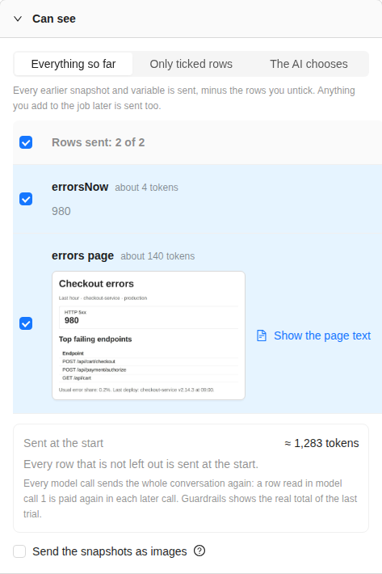

What the AI gets of the earlier snapshots and variables. Three modes:

- **Everything so far**: every earlier snapshot and variable, minus the rows you untick. Anything you add to the job
  later is sent too. This is the default.
- **Only ticked rows**: only the rows you tick. Anything you add later stays out until you tick it.
- **The AI chooses**: the AI gets the names and sizes of the ticked rows, and reads the ones it needs. Anything you add
  later is offered too. In this mode the AI reads the text of the pages, never images. Use it when the step sees large
  snapshots that it does not always need.

The header of the rows says how many rows go, for example "Rows sent: 2 of 3". In **The AI chooses** mode it says
"Rows offered: 2 of 3". Closed, the section says it in one sentence, for example "Sends 2 ticked rows." or "Offers 3
rows. The AI reads the ones it needs."

Each row shows its value and its size, for example "about 140 tokens". The size is the size of the text that the step
sends for the row. One calculation gives the size of a row, the estimate of **What the model gets** and the request of a
run, so they agree. The rows show the values that the top of the **Assistant** panel names, for example "Values of the
run of Oct 10, 13:51": the values of **What the model gets** and **Try it**. **Use the Test capture instead** and **Use
the run instead** change all of them. A variable that these values do not have shows no value and no size: **What the
model gets** says "Empty in this run." for it. A template has no trial: its rows show the last Test capture. A snapshot
row shows the top left of the page in a thumbnail of 240 × 160 px: click it to see the whole image. **Show the page
text** opens **Page text of …**: the text that the model reads, with its size. With no Test capture, it says "No page
text yet. Run a Test capture."

The page text is the text of the page as compact lines: one element a line, a link once with its address, at most
50,000 characters a snapshot. A text that only separates, such as `|`, `·`, `•`, `-` or `—`, is left out. A step set up
before the AI step sends the page text as JSON, as it always did: **Page text of …** then shows the JSON and says "A
step set up as before sends the page text as JSON."

The box under the rows gives the size in tokens: **Sent at the start** and, in **The AI chooses** mode, **If the AI reads
every row once**. A row that the AI reads in model call 1 is paid again in each later model call. **Guardrails** shows
the real total of the last trial. With no estimate, the box says why:

- "No estimate yet: the step is not complete. Instructions: fill it in." The sentence names the part to fill in.
- "No estimate yet: it needs the values of a run or of a Test capture."
- "No estimate: the Preview of the step failed. Open What the model gets to see why."
- "Estimating what is sent at the start…" while the estimate is on its way.

**Send the snapshots as images** also sends the snapshots as pictures. Each image costs tokens, on every run. The box is
off when the model does not read images, or when Anaphora does not know yet. The line under the box says why, for
example "Anaphora does not know yet whether this model reads images. Run the provider's Test." See
[What this model can do](../administration/ai-providers.md#what-this-model-can-do).

#### Can do

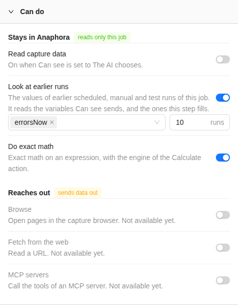

The tools of the step, in two groups.

**Stays in Anaphora** (reads only this job):

- **Read capture data**: reads one row of this run. Its switch follows **Can see**: it is on when **Can see** is set
  to **The AI chooses**.
- **Look at earlier runs**: the values of earlier scheduled, manual and test runs of this job. Choose the **Variables it
  reads**, and how many runs, from 1 to 50. By default, it reads the variables that **Can see** sends, and the ones this
  step fills. A run never reads from earlier runs a variable that **Can see** does not send. When you choose one, the
  section names it, for example "Can see does not send errorsNow, so the step does not read it from earlier runs."
  The AI gets the start time of each run in the time zone of the server (`TZ`), with the zone named, for example
  "2026-10-11 19:48 Europe/Rome (UTC+02:00)", or "2026-10-11 17:48 UTC" on a server in UTC.
- **Do exact math**: exact math on an expression, with the engine of the **Calculate** action.

**Reaches out** (sends data out): **Browse**, **Fetch from the web** and **MCP servers**. These are not available yet.

Each variable in **Variables it reads** must be a variable of the flow. When you rename or remove one, the job cannot
be saved until you remove it from the list too.

Closed, the section names the tools that are on, for example "Look at earlier runs, Do exact math, and the notebook
tools." The notebook tools come with **This job's notebook** under **Remembers**: with no other tool, the section says
"Uses the notebook tools. No other tool." With no tool at all, it says "No tool: one answer from what it sees."

#### Remembers

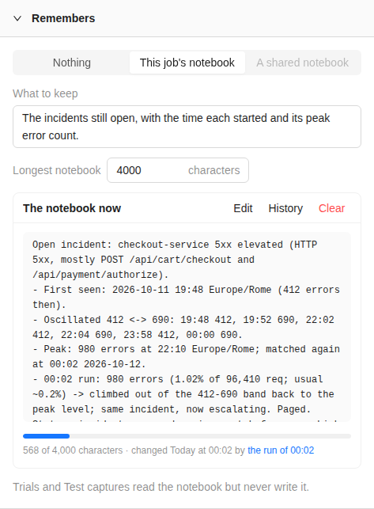

- **Nothing**: each run starts from nothing. This is the default.
- **This job's notebook**: one text for the job, shared by all its AI steps. In each run, the AI can read it and replace
  it.
- **A shared notebook**: not available yet.

**What to keep** tells the AI what to write in the notebook, for example "The incidents still open, with when they
started and the last severity." **Longest notebook** is the limit in characters, 4,000 by default. The AI cannot save a
longer text: Anaphora refuses it and tells the AI the limit.

When the job is saved, **The notebook now** shows the text, its size against the limit of the saved job, and when it
changed and by whom, for example "52 of 4,000 characters · changed Today at 11:21 by a person". A change by a run says
"by the run of 19:57", a link to the runs of the job.

- **Edit** changes the text. Its **Save** stores the notebook at once, not with the job. **Save** is off while the text
  is longer than the limit of the saved job. A **Save** of the text as it was changes nothing, and adds nothing to
  **History**.
- **History** lists the last 50 versions, each by a run or by a person.
- **Clear** empties the notebook. **History** keeps the text.

The limit of the saved job is the largest **Longest notebook** of its AI steps. When you set a larger **Longest
notebook** in this step, a second line says so, for example "The new longest notebook, 20,000 characters, applies after
you save the job." Until you save the job, **Save** keeps to the old limit.

A run saves the notebook when the step ends, and only when the step succeeds or stops with **Keep what is filled in and
go on**. Trials and Test captures read the notebook but never write it. A copy of the job, and a job made from a
template, start with an empty notebook.

#### Guardrails

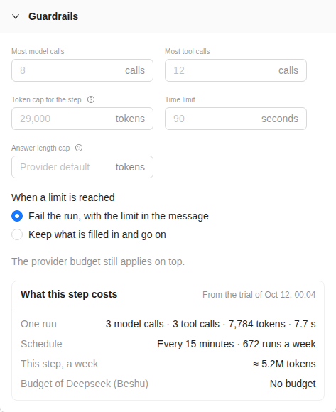

Limits on one run of the step, on top of the provider budget. An empty field shows in grey the value that applies,
set from the step. Type a number to set your own. Until Anaphora has the estimate, an empty **Token cap for the step**
says "Being estimated". With no values of a run or of a Test capture, it says "Set from the run": the run sets the cap
from its own values.

| Field                      | Limit                                                    | When empty                                                                                                                                                                                                                  |
|----------------------------|----------------------------------------------------------|-----------------------------------------------------------------------------------------------------------------------------------------------------------------------------------------------------------------------------|
| **Most model calls**       | Model calls                                              | With no tool: 1 for one plain answer (one variable, no yes/no, no **What it means**), 2 for a JSON answer (see [Fills in](#fills-in)). With a tool: 8                                                                       |
| **Most tool calls**        | Tool calls                                               | With a tool: 12. With no tool: 0, and the field does not show unless the step sets it                                                                                                                                       |
| **Token cap for the step** | Tokens of all the model calls together, input and output | Set from what the model gets, **Most model calls** and the hidden reasoning of the model: see below                                                                                                                         |
| **Time limit**             | Seconds for the whole step                               | 60 with no tool, 90 with one. A step set up as before has no time limit                                                                                                                                                     |
| **Answer length cap**      | Tokens of one answer                                     | The default of the provider                                                                                                                                                                                                 |

An empty **Token cap for the step** gets:

```
first call × (1 + most model calls) + reasoning per call × min(2, most model calls)
```

rounded up to a thousand, at least 8,000 and at most 2,000,000. The first call is the size of what the model gets, in
**The AI chooses** mode plus every row read once. The most model calls are **Most model calls**, with no tool at most 1
or 2. The reasoning per call is room for the [hidden reasoning](#hidden-reasoning) of a model that thinks: 8,000 tokens.
The cap counts it once for a step of one model call, and twice for more, because a tool loop sends the reasoning of a
call back with the next call. It is 0 when the **Test** of the provider saw no reasoning. A provider that was not
tested, or was tested before Anaphora looked for reasoning, counts as one that reasons: click **Test** again to find
out. See [What this model can do](../administration/ai-providers.md#what-this-model-can-do).

For example, a step with a tool whose first call sends about 1,200 tokens gets a token cap of 27,000: 1,200 times 9,
plus 8,000 twice, rounded up. On a provider whose Test saw no reasoning, the same step gets 11,000. A step with no tool
and a JSON answer that sends about 12,700 tokens gets 55,000: 12,700 times 3, plus 8,000 twice, rounded up.

The token cap is checked before each model call: a call whose request would pass the cap is not made. Its answer is not
known before, so a run can pass the cap by the answer of its last call. The tooltip of the field says the same. The
request of each later call holds the whole conversation, also the hidden reasoning of a model that thinks: see
[Hidden reasoning](#hidden-reasoning).

With no tool, the step makes one model call, and one more when its JSON answer is not valid. The grey line and the
token cap count these model calls only, also when you set **Most model calls** higher.

A step set up before the AI step gets no limit at all: one model call, no time limit and no token cap, as before. Its
fields show **No limit**, and **Most model calls** shows 1. When you set one field, every limit applies. See [Steps set
up before the AI step](#steps-set-up-before-the-ai-step).

**When a limit is reached**:

- **Fail the run, with the limit in the message**: the default. The message names the limit and the model call, for
  example "Stopped after model call 2: 11,450 tokens, and model call 3 would send about 10,000 more, over the token
  cap of 12,000", or "Stopped before model call 1: its request of about 14,200 tokens is over the token cap of
  12,000".
- **Keep what is filled in and go on**: the run keeps the variables that the AI filled so far, and goes on.

**What this step costs** uses the last trial: **One run** (model calls, tool calls, tokens, time), the **Schedule** of
the job in runs a week, **This step, a week**, and the budget of the provider, with a bar. When a week of this step does
not fit in the budget, a warning says so: when the budget is reached, every job of that provider pauses. Send less to
the model, run the job less often, or raise the budget. **Ask the assistant for a cheaper setup** asks the assistant for
help.

Only a trial that finished gives a cost of a week. A trial that stopped or failed spent what it spent until then, not
what a run spends. The box then says why it gives no cost of a week, for example "This trial stopped at the token cap,
so the cost of a week is not known." or "This trial failed, so the cost of a week is not known." The trial card says
the same.

### Steps set up before the AI step

An AI step that you add now gets the new settings, with the assistant or with **Set it up by hand instead**: the page
text as short lines, at most 50,000 characters a snapshot, a token cap and a time limit. When you save a new job, all
its AI steps get them, also the steps that come from a template. When you save a job that exists, only the AI steps that you added
get them, also a step that you clone in the flow.

A step that was saved before the AI step keeps what it sent: the page text as JSON, and no limit. A copy of a job or of
a template keeps its steps as they are. The step changes only when you give it a new setting, for example a tool or a
limit, or when you click **Use the new settings**.

When the estimate of such a step is over 50,000 tokens, the editor shows a warning, for example "This step was set up
before the AI step. It sends the page text as JSON, about 387,917 tokens a run, with no token cap." and "The new
settings send the page text as short lines, at most 50,000 characters a snapshot, and add a token cap and a time
limit." **Use the new settings** changes the step in the form, as any other change does. Save the job to keep it.

## Try it

**Try it** runs the step once, as a run does, and keeps nothing. It opens no page, it does not change the job, the
notebook or the variables, and it delivers nothing. Its tokens count on the provider budget.

Try it uses the values of the last run of the job. When the job has no run yet, it uses your last **Test capture**. The
line at the top of the **Assistant** panel says which, for example "Values of the run of Oct 10, 13:51". **Use the Test
capture instead** and **Use the run instead** switch between the two. The assistant, **What the model gets** and the
rows of [Can see](#can-see) use the same values.

A trial that takes more than 10 minutes stops with "The server did not finish in time. Try again." **What the model
gets** stops the same way after 60 seconds.

A job that is not saved yet has no run, so Try it uses its Test capture. With no run and no Test capture, the button is
off and the editor says "Run a Test capture first." Click **Run a Test capture of the actions before it** to get the
values. A template cannot be tried: try the step in a job made from the template.

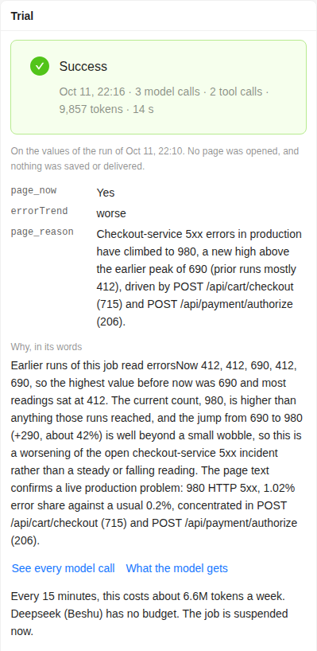

The **Trial** panel shows:

- the status: **Success**, a stop such as **Stopped at the token cap**, or **Error**, with the time, the model calls,
  the tool calls, the tokens and the duration, for example "3 model calls · 2 tool calls · 9,857 tokens · 14 s". A stop
  says whether the step kept values, for example "Stopped at the model call limit after 1 model call. Nothing was
  filled." When no model call was made (for example the budget is spent), it says "No call was made." After an error,
  **Details** shows the answer as the model wrote it;
- the values it ran on, for example "On the values of the run of Oct 10, 13:51. No page was opened, and nothing was
  saved or delivered.";
- the value of each variable: a **yes/no** as Yes or No, and **HTML** as its text;
- **Why, in its words**: the reasons of the AI. After a stop, **The AI's last answer**;
- **See every model call** and **What the model gets**;
- the cost of a week at the schedule of the job, and its share of the provider budget, for example "At the job's
  schedule (every 15 minutes), this step costs about 1.1M tokens a week: 12% of the weekly budget of OpenAI." When the
  job is suspended, the line adds "The job is suspended now.". A daily job says "Daily at 04:05, this costs about …".
  A trial that did not finish gives no cost of a week, and the line says why, for example "This trial stopped at the
  time limit, so the cost of a week is not known.";
- the notebook: what the trial would write, line by line, or "Not changed: the step wrote nothing new.";
- after a second trial, the previous trial in one line. **Compare** shows the two answers side by side, and marks each
  value that changed, or says "No change".

**See every model call** opens **Every model call of the trial**. Each model call shows what it did ("Asks for Do exact
math", "Answers"), its tokens and time. Open one to see the model request: its size and, for the first model call, the
estimate by part, for example "Instructions 306 · Fills in 136 · Can do 445 · Notebook 266"; the model response and how
it ended ("ended with an answer", "asked for tools"); and each tool call with its input and output. A long tool output is cut in the trace, and says so, for example "Cut:
the trace keeps the first 8,192 characters of 21,394." **Copy trace** and
**Raw JSON** are at the top. With two or more model calls, **Expand all** is there too.

A model call with hidden reasoning gives its size in the heading, for example "11,779 tokens (7,830 reasoning) · 1.2 s",
and in the model response, for example "7,950 tokens, of them 7,830 reasoning · asked for tools". See [Hidden
reasoning](#hidden-reasoning).

Under the buttons, one line gives the limits that the trial applied, for example "Limits of this trial: 8 model calls,
12 tool calls, 12,000 tokens and 60 seconds; a limit fails the run." A step with no tool gets 0 tool calls, and the
line leaves them out, for example "Limits of this run: 2 model calls, 12,000 tokens and 60 seconds; a limit fails the
run." With **Keep what is filled in and go on**, the line ends "at a limit the step keeps what it filled." A step set
up before the AI step has no limit, for example "Limits of this run: none." A trace from before Anaphora kept the
limits has no such line.

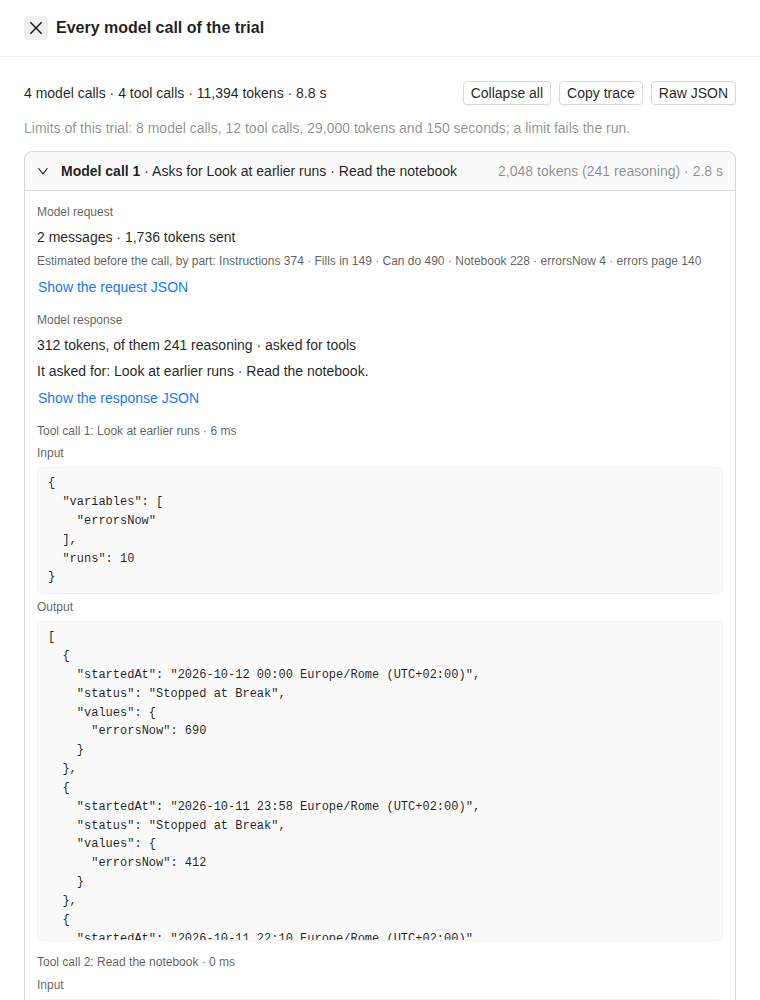

**What the model gets** opens what the first model call sends: the system message, the user message, how the answer is
asked for (from **Fills in**), the tools it may call (from **Can do**), the tokens of each part, and **Not sent, and
why**. A variable of an earlier action that has no value in these values shows there as "Empty in this run." **Copy as text**, **View the messages as JSON** and **Copy the step as JSON** are at the end. Anaphora builds it
with the same code as a run, and calls no model: it spends no token. Before the first trial, the **Trial** panel links
to it too.

The system message tells the model when its values were captured, in the time zone of the server, so that the model
does not guess the time. A run says "This run started 2026-10-11 22:10 Europe/Rome (UTC+02:00)." A trial says where its
values come from: "These values come from the run that started …. Use that time as the time of this run.", or "…
the Test capture that started …". When the start of the Test capture is not known, it says "These values come from a
Test capture. This trial started …". A step set up before the AI step gets no such line. The estimate counts it.

How the answer is asked for follows the provider's **Test** (see
[What this model can do](../administration/ai-providers.md#what-this-model-can-do)):

- **The answer must fit this JSON schema**, with the schema: the Test proved that the provider takes one.
- **The answer is a JSON object**: "The request asks for a JSON object (response_format json_object) with no schema:
  the provider's Test did not prove that it takes one. The system message names each field."
- **The answer is JSON, asked for in words**: "The request asks for no format: the provider's Test found no JSON
  answers. The system message asks for the JSON and names each field."

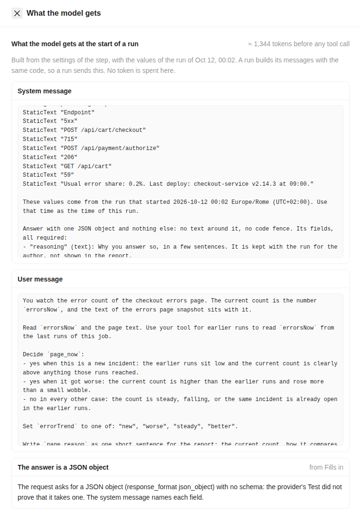

## The assistant

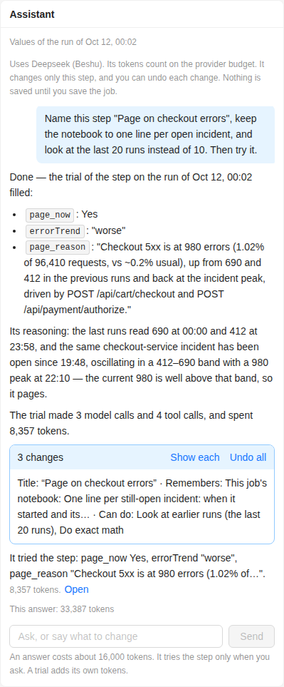

The **Assistant** panel is above the trial. It works on the same values as **Try it**. Write a question or a change in
**Ask, or say what to change**, and click **Send**. The line under the field says what an answer costs, for example
"An answer costs about 14,000 tokens. It tries the step only when you ask. A trial adds its own tokens." The estimate
counts two model calls: one that makes the changes, and one that answers. An answer that tries the step makes one more:
one model call asks for the trial, the next reads it, the last answers. After the answer, "This answer: 12,460
tokens" says what it cost, its trials included. The line under the field then gives what that answer cost without the
tokens of its trials.

The assistant may change this step, and only this step: the title, the **Instructions**, **Fills in**, **Can see**, the
tools that stay in Anaphora, **Remembers** and **Guardrails**. Each change is a card with its reason, and goes into the
step at once.

- The changes of one answer are a group, for example "5 changes", with one line per change, such as "Instructions:
  adds “Page only for a new incident.”". **Show each** shows the cards. A change of **Instructions** shows the lines it
  added and removed.
- **Undo** on a card takes that change back. The card then says **Undone**. When you changed that field after the
  assistant, Anaphora asks first, for example "You changed Instructions after the assistant. Undo anyway?": **Keep
  mine** keeps your text, **Undo** takes the field back to what it was before the change.
- **Undo all** takes back every change of the group. When you changed some of its fields after the assistant, it asks
  once and names them: **Keep mine** takes back the other changes and keeps your fields, **Undo** takes back all. When
  you undid some of the changes already, the button is **Undo the rest**. When all are undone, the group says **All
  undone**.

Other things it only proposes, as a card for you to decide:

- **Something to add to the flow**, for example a snapshot before the step: **Add it** puts a **Navigate** with a
  snapshot before the step, and **I have one** sets the card aside.
- **A Conditional block and a Break after this step**, when the report must go out only in some runs. The card says
  when the run stops, for example "The run stops when page_now is No.". **Add them** puts the block and its **Break**
  after the step, and **Open the block** opens it. **Set aside** closes the card. The assistant gets the actions after
  the step. When a Conditional block with a **Break** after the step already tests the variable, it proposes no second
  one, and says in words what to change in it, if anything.
- **A tool that reaches out of Anaphora**: not available yet. **Set aside** closes the card.
- **Something to check** in another part of the flow: **Set aside** closes the card.

The assistant tries the step only when you ask for it, for example "try it", "test it" or "run the step", and on the
**Try** screen of a new step. It tries at most three times in one answer. Each trial shows as one line with its answer and tokens, and
**Open** opens its model calls. It never saves the job. Its text shows with simple formatting, such as bold, lists and
code. Its links open only web addresses.

The assistant writes a time as the editor shows it, in your time zone and with no zone name, for example "the run of
Oct 11, 16:02" or "the trial of Oct 11, 16:03". A time from earlier runs or from the notebook keeps the zone it names.
It says a **yes/no** value as "Yes" or "No", as the editor shows it, and describes a **yes/no** variable as "yes when
…, no otherwise". It gives each value of a trial word for word, as the trial shows it: a text in quotes, a **yes/no** or
a number with no quotes, for example page_now: Yes. It writes a count with a comma between the thousands, for example
6,779 tokens.

Its tokens count on the provider budget, like a trial. One answer stops at 12 model calls, 60,000 tokens or 120
seconds. The answer then says which limit stopped it, and the changes so far stay. A fourth trial in one answer is
refused, and the answer goes on. When the server does not answer in time, the panel says "The assistant did not answer
in time. Send your message again."

The conversation and the trials of a step stay while you switch the tabs of the job, and after you create the job. A
reload of the page forgets them.

### Explain this trial

At the end of **Every model call of the trial**, **Explain this trial** asks the assistant why the step did what it did.
Next to the button, a line says what an explanation costs, for example "An explanation costs about 10,000 tokens." An
explanation is one model call with no tool: the assistant reads a short summary of the trial in words, and changes
nothing. The estimate adds about 3,800 tokens for the [hidden reasoning](#hidden-reasoning) of a model that thinks. It
leaves them out when the trace shows no reasoning in any model call.

The answer comes under **Explained by the assistant**, with suggestions. **Apply** puts a suggestion into the step, and
**Undo** takes it back. A proposal for the flow comes as a card, as in the panel. With nothing to change, it says "The
assistant suggests no change." **Ask again** asks once more. "This answer: N tokens" says what it cost.

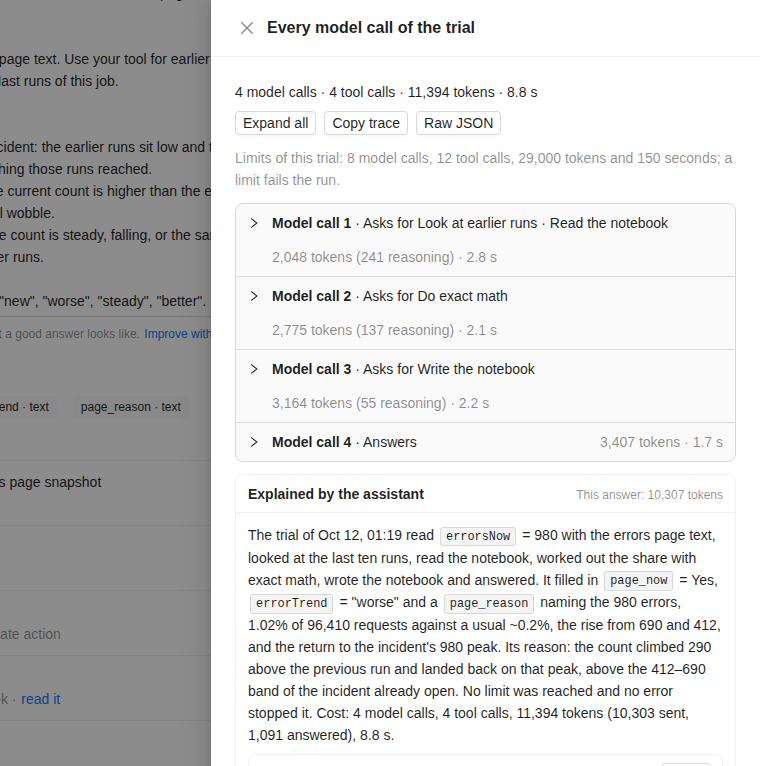

On the Runs page, the same button is **Explain this run**. There, a suggestion has **Open the step** instead of
**Apply**: open the step, then make the change in the editor. **Explain this run** and **Open the step** need write
access to the space.

## Runs

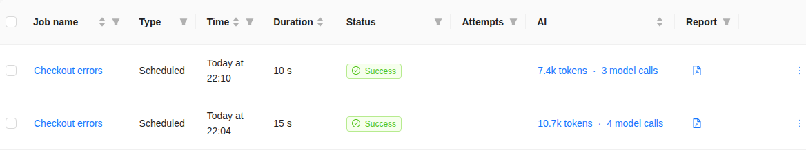

The **AI** column of the **Runs** page says what the AI steps of each run cost, for example "1.1k tokens · 2 model
calls". Each phrase stays on one line: a narrow table breaks the cell only between them. Click its header to sort the
runs by the tokens of their AI steps. When a limit stops a step, the column names the limit, for example "Token cap · 5
model calls": in yellow when the step kept what it filled and the run went on, in red when the run failed. When a step fails, it shows "AI error" in red. A run that a **Break** stopped has the status
**Stopped at Break**. The message of a failed run names what happened, with no technical prefix. A run with
no AI step shows "no AI".

Click the cell to open the **AI trace** of the run. It has the same content as a trial: the status, **Why, in its
words**, the variables, the notebook, every model call, and the limits of the run, for example "Limits of this run: 8
model calls, 12 tool calls, 12,000 tokens and 60 seconds; a limit fails the run." It also has **Compare** with the
previous run of the job, **Explain this run**, and **Open the step**, which opens the step in the editor.

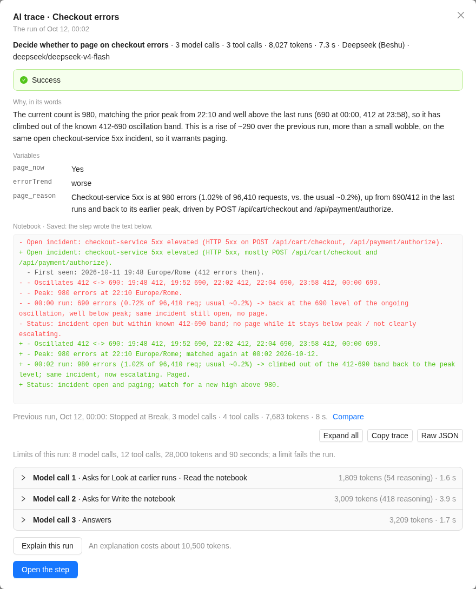

A **Test capture** runs the AI steps too. Its result has an **AI** tab with the same trace for each AI step, and the
line "Limits of this Test capture: …". When the Test capture fails, there is no **AI** tab: the traces of the AI steps
show under the error.

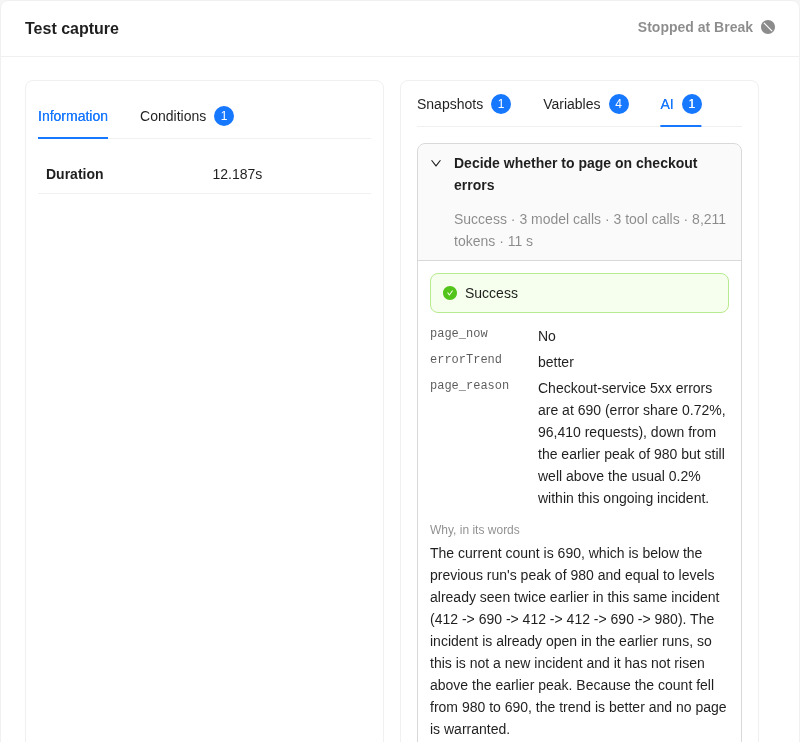

### When a step stops at a limit

1. Open the trace from the **AI** column. The status names the limit, and **The AI's last answer** shows where the AI
   was.
2. Click **Open the step**, then open **Guardrails**.
3. Do one of these:
   - Raise the limit that stopped the step.
   - Send less: **Only ticked rows**, or **The AI chooses** for large snapshots. Switch off a tool that the step does
     not need.
   - Choose **Keep what is filled in and go on**, when a part of the answer is enough.
   - Click **Explain this run**, and let the assistant suggest a change.
4. Click **Try it** to check the change, then save the job.

## Costs and limits

- An AI step costs tokens: what each model call sends, and its answer. Each model call sends the whole conversation
  again, so a step with tools costs more than a single model call. Costs show in tokens, not in money.
- The provider budget applies on top of the guardrails. When a run reaches it, the job pauses, and every further model
  call on that provider is refused until the window rolls over. See
  [Token budgets](../administration/ai-providers.md#token-budgets).
- Trials, Test captures and the assistant count on the same budget. They never pause a job: the budget refuses their
  next model call. The provider list splits the tokens by what spent them.
- The guardrails that you leave empty come from the step: see [Guardrails](#guardrails). The grey line under **It can**
  shows them.
- A step set up before the AI step sends what it always sent, with no limit, until you change it: see
  [Steps set up before the AI step](#steps-set-up-before-the-ai-step).
- The values that the editor sends for a trial, a Preview or the assistant can be up to 8 MB. When they are larger
  with the images, the editor sends the snapshots as page text only, and the **Assistant** panel says so. When they are
  still too large, the editor says "The Test capture is over 8 MB as page text. Untick snapshots under Can see, or
  capture smaller pages."

### Hidden reasoning

A model that thinks, such as a DeepSeek model, writes hidden reasoning before its answer. Its tokens are part of the
answer, and count on the provider budget. With a tool, the reasoning goes back to the model in each later model call
(DeepSeek requires it), so one later call can send most of the token cap. The check of the token cap before each model
call counts it. **See every model call** shows the reasoning of each model call: see [Try it](#try-it).

The **Test** of the provider notes whether the model writes hidden reasoning. Unless the Test saw none, the token cap
that Anaphora sets for a step makes room for it: see [Guardrails](#guardrails).

## For AI agents and scripts

An AI agent or a script can set up, try and read AI steps through the JSON API of your instance, described at its
`/llms.txt`: see [API for AI agents](../administration/agent-api.md).
