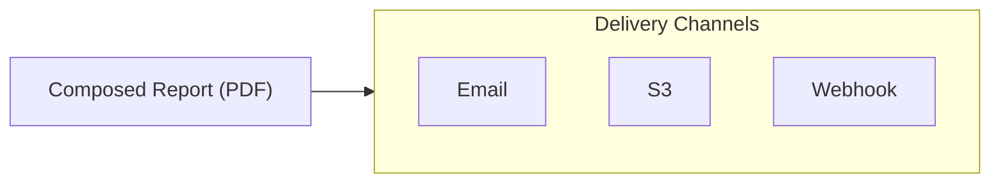

# Delivery configuration

The **Deliver** tab configures where and how reports are sent. Anaphora can deliver to multiple channels: email,
webhooks, and S3 archiving.

## Overview

After composition, Anaphora delivers the report through the interfaces you configure:



## Delivery interfaces

Delivery interfaces are reusable destination configurations. Configure them once under **Delivery Interfaces** in the
sidebar, then select them in any job. You can also select **Create new** in the job's **Delivery Interface** menu.

### Available types

| Interface             | Best for             | Features                       |
|-----------------------|----------------------|--------------------------------|
| **SMTP**              | Corporate email      | SSL/TLS, attachments           |
| **Mailgun**           | Transactional email  | High volume, tracking          |
| **Webhook**           | Integrations         | Custom payloads, any endpoint  |
| **S3 Object Storage** | Archival, compliance | Historical records, versioning |

### Reusability

You can configure multiple interfaces of each type:

- Different SMTP servers for different teams
- Separate S3 buckets for different retention periods
- Several webhooks for different integrations

## S3 archiving

S3 is useful for historical archives and compliance workflows.

In the job, set **File type** to **PDF Report**, **HTML Report**, or **PDF & HTML Report**.

### Use cases

| Scenario                     | Benefit                                        |
|------------------------------|------------------------------------------------|
| Historical reference         | "What did this dashboard look like on date X?" |
| Compliance evidence          | Immutable records for audit requirements       |
| Long-term retention          | Store reports beyond housekeeping limits       |
| Cross-system integration     | Other tools can access archived reports        |

## Email delivery

Anaphora sends reports by email through SMTP or Mailgun.

### Email options

| Field            | Description                                                     |
|------------------|-----------------------------------------------------------------|
| Attachments      | Select **Report as PDF** to attach the PDF report to the email. |
| Message template | Customizable email body with variables, `prev` and `delta` included. |
| Recipients       | List of email addresses to send the report to.                  |

:::tip Recipients
Mark each recipient address as an **Individual mailbox** or a **Group address**. Click a recipient to change its type.
Emails sent to individual mailboxes include a snooze and unsubscribe link in the footer. Group addresses do not include
these links.
:::

A snooze pauses the job's emails to that recipient for 5 minutes to 8 days. The recipient must pick a duration. The
unsubscribe link stops the emails.

Each installation signs these links with its own secret, which Anaphora keeps in the database. Links in emails sent
before the upgrade to this version keep working for 90 days. A snooze or an unsubscribe made from such an older link
ends at the end of those 90 days, and the page tells the recipient. To make it permanent, the recipient uses the link
in a newer report.

## Webhook delivery

Webhooks connect Anaphora to any HTTP endpoint for custom integrations.

### Webhook configuration

| Field              | Description                                                                                                                                             |
|--------------------|---------------------------------------------------------------------------------------------------------------------------------------------------------|
| Message template   | Customizable message body with variables.                                                                                                               |
| JSON body template | Define the JSON payload with variables. Shown instead of **Message template** when **Define body in job instead** is selected in the Webhook interface. |

### Webhook use cases

| Integration           | Description                            |
|-----------------------|----------------------------------------|
| Ticketing systems     | Create tickets for alerts              |
| Chat platforms        | Create messages in collaboration tools |
| Data pipelines        | Feed report data to analytics          |
| Custom dashboards     | Update external status pages           |

## Multi-channel delivery

Send the same report to multiple destinations:

### Configuration

1. Click **Delivery Interface**
2. Select an existing interface, or **Create new**
3. Configure the destination
4. Repeat for additional channels

### Example: alert with archive

```
Delivery 1: Webhook e.g. Slack (immediate notification)
Delivery 2: Email (stakeholder distribution)
Delivery 3: S3 (permanent archive)
```

## Send through a delivery only if…

Each delivery can have its own condition. Then one capture serves different audiences. For example, the on-call
channel gets the report only when the error count is high, and the daily digest always gets it.

1. In the **Deliver** tab, open the delivery.
2. Select **Send through this delivery only if…**.
3. Select a **Variable**. You can select a number or a text that the capture fills (**Capture value**, **Calculate** or
   an AI step).
4. Set **Condition operation** and **Condition value**. For a yes/no variable of an AI step, set **Condition** to
   **is Yes** or **is No**.
5. Set **Send when the condition** to **holds** or **does not hold**.

The collapsed delivery shows a summary of the condition, for example `only if errors greater than 100`.

How a run applies the condition:

- The run tests the condition after the capture, on the values of that run.
- When the condition fails, the delivery sends nothing. The log says why. This is not an error: there is no retry, and
  the health of the delivery interface does not change.
- A variable that the run did not fill fails the test. A number test on a value that is not a number also fails. A
  yes/no value counts as `1` or `0`, and a text such as `1500` counts as its number.
- A delivery with no condition always sends.
- When the condition of every delivery fails, the Runs page and the Jobs list show **Skipped**. The run keeps its report.
  The run does not count as sent, so it does not start the throttling period. The next report compares with the report
  before it (see [Values of the previous report](./composer.md#values-of-the-previous-report)).
- A [withheld report](#withheld-reports) stays withheld on every delivery, whatever its condition gives.
- A test send ignores the conditions and sends through every delivery. The log says what a run would do.

To stop the whole run instead, use a **Break** in the capture, or the **Send the report only if…** box of the job.

### Partial success

With multi-channel delivery:

- Anaphora tries each channel independently
- Partial success (some channels succeed, others fail) is logged
- The run and the Jobs list show **Delivery issue**. Job health counts a report that reached nobody as failed, and a
  report that reached some destinations as partly delivered. A delivery that its condition skipped did not reach
  anybody, so it does not make a failed run partly delivered.

## Report links

The links in a delivered email, Slack message or webhook are private. Each run has a secret token, and the links carry
it. The report files (PDF, HTML, images) open for a link with that token, or for a signed-in member of the run's space.
Anyone else gets "not found".

## Withheld reports

When a text block of the report fails, or the report cannot be built, Anaphora does not deliver it. No recipient, bucket
or webhook gets it. The Jobs list shows the job as **Not delivered**, and job health counts the run as failed. The run
does not count as sent, so a throttled job sends the next run. See [Composer](./composer.md#errors-in-a-text-block).

With the S3 file type **PDF & HTML Report**, nothing is uploaded when the HTML copy cannot be built.

## Testing delivery

A test send ignores the condition of each delivery, and sends through every delivery.

Every delivery config includes a test button: **Run with test email** for SMTP and Mailgun, **Test run** for Webhook
and S3 Object Storage. Use it to verify the configuration before you save the job. **Test run without delivery** runs the job
and shows the output without notifying any recipients. A test withholds a report with a broken text block in the same
way, and says so. Anaphora logs all steps of the capture and delivery process for troubleshooting. Each AI step adds
one line, for example `AI step "Rate the errors" answered after 2 model calls: 1,234 tokens, 4.1 s.` When the
token budget of the provider refused the step, the line is `AI step "Rate the errors" failed: the provider's token
budget refused it before its first model call, 0.0 s.` When the step stopped or failed before any model call finished
for another cause, the line says so, for example `AI step "Rate the errors" stopped at the time limit before any
model call finished, 150.0 s.`
Select **Debug test run** in the button menu to also receive a video of the capture process.

## Next steps

- [Delivery interfaces](../delivery-interfaces/): configure global interface settings
- [Basic examples](../basic-examples/): see complete job examples
